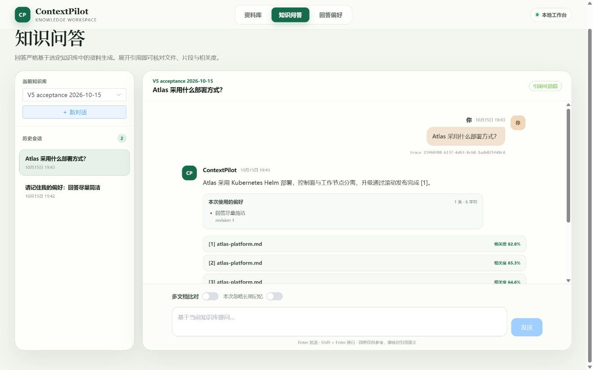
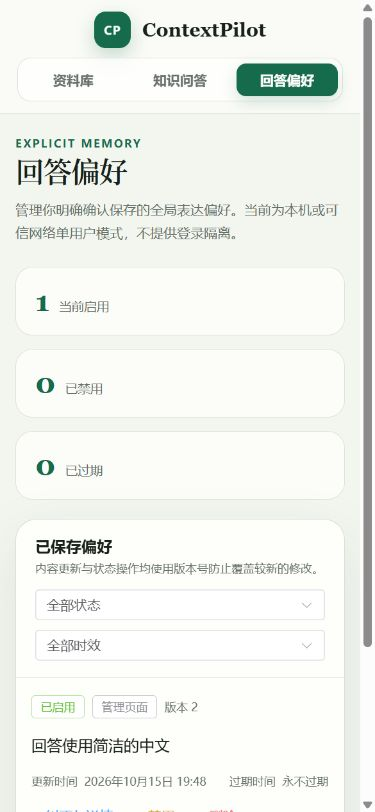

# V5 第一阶段显式记忆验收报告

> 日期：2026-10-15（Asia/Shanghai）。结论：Slices 1–7 已完成，第一阶段通过验收。仅适用于本机或可信网络单用户；不代表登录、多用户隔离或自动记忆已交付。

## 交付与检查点

1. **生产验收入口与数据库闭环**：新增 `v5-production-acceptance`，运行全量回归并强制 Docker 环境门禁；12 个冻结路由案例直接校验生产策略。补齐 20 条活动/100 条未删除记忆的并发容量测试，以及跨会话纠正、禁用、过期、删除和历史 revision 固定测试。
2. **真实服务与问题修复**：新增独立 `v5-live-model-acceptance`、公开 `v5-live-memory-v1` 数据集和脱敏逐次结果。首次人工复核发现 V4 会在有效引用旁附加“文档未提及某能力”的缺证据推断；修复生产综合结果过滤，并新增中文、英文、混合事实行和标题形式的回归案例。修复后重新完成同一组真实服务对照。
3. **页面与最终门禁**：验证实际 SSE 偏好卡片、跨会话、刷新恢复、单次忽略复位、管理确认/新版本、删除后历史隐藏正文；通过桌面、窄屏检查、前端类型检查/构建和后端完整构建。

上述检查点属于同一 Slice 7，不创建新的路线阶段。V6、MCP、模型工具调用和检索优化没有因此获得实现授权。

## 可复跑命令与工程结果

在 `backend/`，使用仓库规定的 JDK 21：

```powershell
.\mvnw.cmd -Pv5-production-acceptance package
.\mvnw.cmd -Pv5-live-model-acceptance test
```

真实服务命令读取 gitignored `config/application-local-secrets.yml`，会调用收费模型。数据库为独立 Testcontainers PostgreSQL/pgvector，上传目录为 `backend/target/v5-live-uploads`。仅使用版本化公开合成 Atlas/Borealis 文件，不接触用户数据库或私密资料。

| 门禁 | 本次结果 |
| --- | --- |
| 修改前全量基线 | 372 项，369 通过，3 项条件跳过，0 失败/错误 |
| 新增容量与历史定向测试 | 7/7 通过，真实 PostgreSQL |
| 冻结生产路由及研究过滤定向测试 | 24/24 通过 |
| 最终 `v5-production-acceptance package` | 393 项，391 通过，0 失败/错误；2 个付费模型测试按开关跳过；JAR 构建成功 |
| `v5-live-model-acceptance test` | 单独启用并通过；16 次回答记录，0 失败/错误/跳过 |
| 前端 `npm run typecheck` / `npm run build` | 均通过；保留既有大 chunk 提示 |

全量命令包含原 V1–V4 回归、冻结 V5 离线评估与生产实现测试。两个跳过项为 V4 旧评估专用 Planner 实验和新的 V5 真实服务测试；V5 已单独实际执行，V4 的评估专用 Planner 不属于本次生产链路。数据库测试没有跳过。

## 冻结生命周期证据对应

| 案例 | 真实生产测试 |
| --- | --- |
| LIFE-001 | `CreateUserMemoryActionPersistenceTests.unconfirmedRejectedAndExpiredProposalsHaveZeroMemorySideEffects` |
| LIFE-002、003 | `repeatedAndConcurrentConfirmationCreatesOneMemoryAndPinsResultResource` |
| LIFE-004 | `distinctConfirmedProposalsReuseTheSameNormalizedActivePreference`、`UserMemoryPersistenceTests.exactNormalizedDuplicateReusesTheOwnedActiveAggregate` |
| LIFE-005 | `UserMemoryManagementPersistenceTests.listsDetailsAndKeepsImmutableManagementRevisions` |
| LIFE-006、007、008、010 | `MemoryContextPersistenceTests.newSessionsUseCurrentRevisionsWhileHistoryKeepsTheActualVersion`；删除隐藏及预算另由 `recordsOnlyTheStableActiveContextWithinBothBudgets` 覆盖 |
| LIFE-009 | `rejectsStaleVersionsAndDuplicateReactivation` |
| LIFE-011 | `UserMemoryPersistenceTests.persistsTheSeedOwnerAggregateAndImmutableInitialRevision` 和 `UserMemoryControllerTests.rejectsClientSuppliedOwnerFields` |
| LIFE-012 | `UserMemoryManagementPersistenceTests.concurrentCreationCannotExceedActiveOrStoredLimit` 两个并发参数案例 |

冻结的路由、偏好与安全原型继续保持原阈值；生产 SSE、IGNORE、依赖失败降级、RAG Prompt、V4 计划与引用隔离也纳入全量回归。测试方法数、生命周期覆盖数和重复调用数不能相加冒充独立任务数。

## 真实 DeepSeek / DashScope 对照

使用生产文档上传/解析、DashScope `qwen3.7-text-embedding`、1024 维 pgvector 检索、生产提案确认、记忆读取/历史持久化和生产 RAG/V4 服务。聊天配置为 `deepseek-v4-flash`，服务实际返回的模型名称为 `deepseek-flash`，逐次结果保留该原始名称；不据此推测供应商内部版本。

四种场景：英文偏好、Markdown 要点、简洁偏好、当前中文请求覆盖长期英文偏好。每种场景分别运行普通 RAG/V4，每条先 IGNORE 后 USE，新建独立会话，共 16 次回答。它们是 4 种表达场景、8 个路径实例，不是 16 个独立知识任务，也不是待建设的 50 任务统一基线。

| 路径 | IGNORE 风格匹配 | USE 风格匹配 | IGNORE 总 tokens / 平均耗时 | USE 总 tokens / 平均耗时 |
| --- | --- | --- | --- | --- |
| 普通 RAG | 2/4 | 4/4 | 2448 / 2226.25 ms | 2745 / 1982 ms |
| V4 | 3/4 | 4/4 | 4715 / 4932.5 ms | 4670 / 4736.75 ms |

总体风格匹配从 5/8 到 8/8，提升 37.5 个百分点；去掉当前请求覆盖场景，偏好遵循为 6/6，覆盖正确率为 2/2。所有 USE 记录只注入当前已确认的 1 条 revision 1，历史恢复一致；所有 IGNORE 记录没有记忆上下文；V4 对照的计划保持一致。每次回答恰好一条模型调用记录，V4 输出不超过 1800 字符，仍未设置请求级 `max_tokens`，90 秒硬超时未改变。本轮回答总 usage 为 14578 tokens，不包含 Embedding 或此前调试轮，也不是费用估算。

数据见[修复后逐次结果](../../evals/reports/2026-10-15-v5-live-acceptance-results.json)。[修复前结果](../../evals/reports/2026-10-15-v5-live-before-grounding-fix.json)保留自动通过但人工发现问题的事实，不能作为最终通过证据。最初一次验收脚本因审计查询误用字段名失败，修正为实际 `model_call.message_id` 后才完成对照；失败运行未计入上述指标。

风格规则是机械指标：英文汉字少于 10 且至少 10 个英文词；中文至少 20 个汉字；要点至少 2 个 Markdown 条目；简洁至多 600 字符。自动检测只证明这些条件和引用编号/范围合法，不能单独证明语义正确。因此自动报告保留 `AUTOMATED_GATES_PASSED_MANUAL_REVIEW_REQUIRED`；本报告记录最终人工复核结论：16 条公开回答的具体部署事实可回溯到 Atlas/Borealis 语料，最终 V4 回答没有再出现上述缺证据推断。部分普通 RAG 回答包含与问题关联较弱但有语料支持的容量/计费补充；这是后续答案聚焦质量的改进项，未作为召回或效率收益宣传。

## 页面验收

在现有本地实例中建立专用公开样例知识库 `V5 acceptance 2026-10-15`，上传公开 Atlas 文件。通过页面生成并确认“回答尽量简洁”提案，在另一个会话提问；回答出现可展开的 1 条/6 字符/revision 1 卡片，刷新后恢复一致。单次忽略后新增回答没有偏好卡片，开关自动复位；管理页确认纠正后版本推进为 2。测试结束逻辑删除这一条测试偏好，活动列表恢复为空，历史展示“该偏好已删除 / revision 1”。公开知识库及会话保留用于复核，没有更改既有知识库内容。

1440×900 桌面与 390×844 窄屏均可使用；窄屏文档 `scrollWidth` 与 `clientWidth` 同为 375（扣除滚动条），无横向溢出，控制台没有捕获到 error/warn。临时视口已复原。页面实例用于检验未改变的记忆 UI；研究过滤修复由独立实时测试与最终构建验证，未重启用户原有后端进程。





## 边界与后续

本次研究过滤针对观察到的中英文非规范缺证据表述，按行移除并沿用 `RESEARCH_UNSUPPORTED_CONTENT_REMOVED/PARTIAL`。允许的固定文件名缺证据句式和正常证据结论仍保留。该规则不是通用语义蕴含验证器，不能据此声称消除了所有幻觉；不能通过记忆、引用编号或格式绕过 grounding 合同。

V5 第一阶段验收闭合。下一项工作按唯一产品路线推进可复现展示和统一评测基线；V6 受控工具与 V7 检索优化仍须另行批准详细合同。
